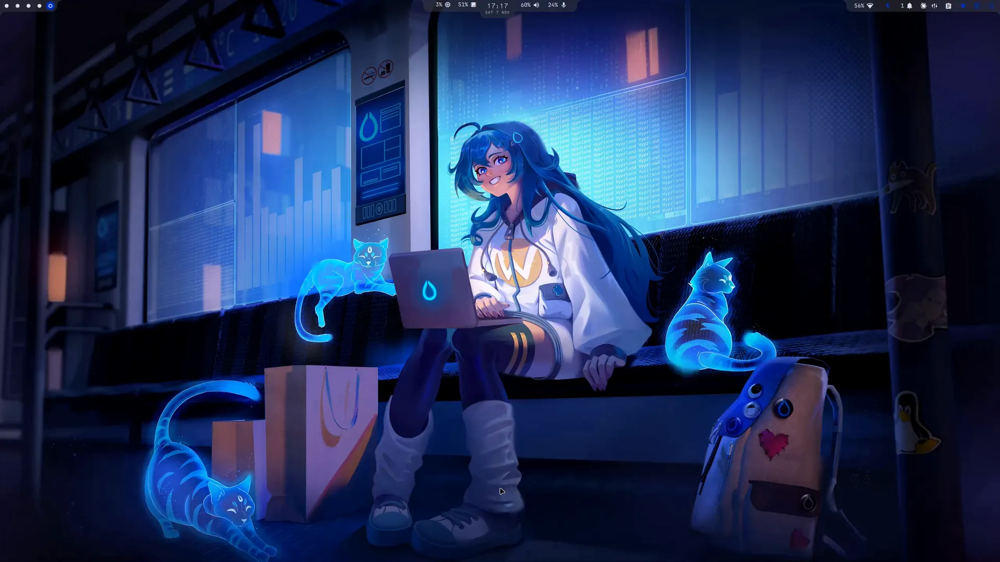

# sleepyshell



A desktop shell for [Hyprland](https://hypr.land), written in [Quickshell](https://quickshell.org) (QML) with
Python helpers. Floating islands on the top edge, a control centre, notifications, an on-screen display, a
polkit agent, a lock screen, a keybinds window and a full settings app, all themed from your wallpaper or from
a community colour theme.

**Hyprland only.** Sleepy Shell runs on Hyprland 0.55 or newer with the Lua config (`hyprland.lua`), on Arch
Linux and Arch-based distributions; the installer refuses anything else.

**Built to be modified.** sleepyshell is plain QML and Python with no build step: every widget is a folder,
every settings tab is a file, every setting is one line in a schema, and the bar reloads itself when you save.
A test kit in the repository lets you compile, preview and deploy a change with a backup and an automatic
rollback, so breaking your own desktop is hard. See [Make it yours](#make-it-yours).

**It asks before it touches your files.** The shell writes its own files, and changes a file of yours only
after showing you exactly what will change, with a backup kept. See [Security](#security).

## Contents

- [Features](#features)
- [Dependencies](#dependencies)
- [Install](#install)
- [Keybinds and scripting](#keybinds-and-scripting)
- [Make it yours](#make-it-yours)
- [Repository layout](#repository-layout)
- [Development](#development)
- [Security](#security)
- [Licence](#licence)
- [AI disclaimer](#ai-disclaimer)

More screenshots and clips in the [gallery](gallery/README.md).

## Features

The bar is three islands on the top edge of every monitor. The centre one grows into the control centre; a
side island widens so a widget's dropdown hangs flush under it ("Extend"), or the dropdown floats as a card
("Float"). How fast they open, how the motion eases, the centre island's stepped outline and the islands'
padding are settings.

<details>
<summary><b>Left island: workspaces</b></summary>

- Dots for this monitor's workspaces; 1 to N always shown (N is a setting), higher ones while they exist.
- A sliding accent disc that stretches into a pill while it moves; filled dot = has windows, ring = empty,
  urgent colour for an urgent window. Optional wave on a switch.
- Shapes: circles, squares, triangles, numbers or a glyph of your own.
- Click focuses (and creates) a workspace; the scroll wheel goes to the previous or next one. While a special
  workspace is shown a name pill appears; a click puts it away.
- No window title on the bar, by design.
</details>

<details>
<summary><b>Centre island: clock, readouts and the control centre</b></summary>

- The clock, with its own font (IBM 3270, CPMono, 0xProto, JetBrains Mono or any installed font), size and Qt
  time format, and an optional date line.
- Beside it: CPU and memory percentages from `/proc` every 2 s, and the audio pill with speaker and microphone
  halves (left click opens the audio panels, right click mutes, scroll changes by 5 %, middle click opens the
  mixer). Either side can be hidden or swapped.
- A peek row that slides out under the clock for a moment after a volume, microphone or Caps Lock change.
- Hover (optional, with a close delay) or click opens the **control centre**:
  - the full date, uptime and a system panel: CPU usage and load, memory and storage meters, CPU and GPU
    temperatures;
  - six quick-setting tiles you can reorder and hide: Wi-Fi (with the network list and a password prompt under
    it), Bluetooth (with the device list: connect, pair, forget), Do not disturb, Keep awake (an idle inhibitor
    that survives a reload), Power profile (cycles power-saver, balanced, performance) and Night light;
  - a tools grid: Keybinds (the keybinds window), Wallpapers (the picker), Calendar, Audio mixer, Shuffle
    colours, Sleepysettings, and a Colour picker (hyprpicker) and Shuffle wallpaper (SUPER + SHIFT + W does the
    same) that are off until you switch them on in the Centre island tab and drag them into place, plus your
    own tools (an installed app, a command with or without a terminal, or a link), each with a label and a
    Material icon picked by name. A tool whose program is missing is greyed with the reason;
  - output and input audio panels (mute, slider, device list; Easy Effects chains resolve to the hardware node)
    and a backlight slider on laptops;
  - a Power button that opens the session menu.
- The centre island can be stepped (a deeper outline under the clock) and the open panel uneven.
</details>

<details>
<summary><b>Right island: widgets</b></summary>

Reorder and hide them in the Right island tab. Default order:

- **Caps Lock** indicator, shown only while Caps Lock is on.
- **Package updates**: the count of repository and AUR updates, shown only when there are some. The dropdown
  lists up to 30 packages, refreshes, and starts the update in your terminal; right click re-checks. Checks
  every 30 min (a setting).
- **Network**: glyph plus Wi-Fi signal; the Wi-Fi fan is filled to the exact percentage beside it, not in four
  steps. The glyph gets a "!" (a crossed cable when wired) while connected without
  internet, from NetworkManager's own connectivity check; a network that needs a sign-in page says so. The
  dropdown shows the connection, the network list (scans while open,
  sorted connected, saved, by signal; click to connect or disconnect; a password prompt inline; failure
  reasons), live download and upload speed, and a button to the terminal network settings.
- **Bluetooth**: the number of connected devices while the adapter is on.
- **Battery**: percentage and glyph on laptops, red under the low level while discharging, accent while
  charging; click opens the Power tab.
- **Privacy**: microphone, camera and screen-share indicators, only while something uses them (read from
  PipeWire; Easy Effects, meters and muted streams are ignored; portal screencasts are detected). The dropdown
  names the app and what it uses (the program, where the stream carries only its voice library's name, as
  Discord's does).
- **Notifications**: the bell with a count while notifications wait, muted under Do not disturb. The dropdown
  has a Do not disturb switch, Clear all (the cards swipe out one by one) and the cards, newest or oldest
  first.
- **Clipboard**: opens walker's clipboard mode; hidden unless walker is installed.
- **Keybind overlay** and **click circles**: the overlay names each keybind as you use it ("Super + Enter") in a
  pill at the bottom of the screen, the circles draw a ring at each left or right click; useful for screen
  recordings and teaching. Each is switched by its own shortcut (Keybinds tab, Shell shortcuts; Super+Shift+K and
  Super+Shift+L suggested), and a small indicator shows on the island only while it is on. Hyprland reports only
  keybinds that fire, never typing, and only while the overlay is on; it needs one line at the top of
  `hyprland.lua` (the Keybinds tab offers Set up).
- **Recording**: a blinking red dot while a screen recorder says it is recording (over the shell's IPC, below).
- **System tray**: StatusNotifier icons with a themed right-click menu (with submenus); middle click for the
  secondary action; the wheel scrolls the item. Hidden when empty.
</details>

<details>
<summary><b>Notifications</b></summary>

- The shell is the notification daemon. Toasts appear under the bar, top right, newest on top or at the
  bottom, up to a set number at once; a notification's own timeout else 5 s; hovering holds them.
- Arrivals during a hover queue as compact rows, then a "+N more" pill that opens the list.
- Critical notifications never time out and show even under Do not disturb.
- A card shows the icon, summary, app and age, the body as plain text, the app's action buttons and a close
  button. Clicking a card runs the app's default action, else focuses the app's window, then dismisses it.
- Images and icons load only from your own machine; a web address in a notification is never fetched.
- Screenshot notifications (Hyprshot, or a file in a Screenshots folder) show a large preview; click copies the
  image, with buttons to open it or show it in its folder.
- The history keeps the newest 100. Waiting notifications survive a hot reload without re-toasting.
- Low battery: a notification at the low level and a critical one at the critical level with a 60 s countdown
  to the chosen action; plugging in cancels it.
</details>

<details>
<summary><b>Popups and overlays</b></summary>

- **On-screen display**: volume, microphone and Caps Lock, as the peek under the clock, or as a pill at the
  bottom over a fullscreen window.
- **Idle dim**: a fading black layer per screen when hypridle says so.
- **Keybinds window**: every Hyprland keybind in one searchable, grouped list, read-only, as a normal floating
  window. Each bind says what it is for: your own description (written on the Keybinds tab), a plain name for
  common actions ("Open the terminal", "Volume up"), the app it opens, or the comment above it in your config;
  what it runs is shown under it. SUPER + / (in the example binds) or the Keybinds tool in the control centre
  opens and closes it.
- **Calendar** (with khal): a month grid with per-calendar colour dots and event chips, the selected day's
  events with times, Today, New event and Open in khal (both in your terminal), full keyboard navigation, the
  wheel changes month. Re-reads khal every 10 min while open.
- **Polkit agent**: a blurred full-screen prompt with the action, the message, a password field and Cancel and
  Authenticate; Escape cancels at any time. It replaces hyprpolkitagent.
- **Session menu**: Lock, Sleep, Log out, Reboot and Shut down, with letter keys; the last three must be held
  for 600 ms (a ring fills).
- **Wallpaper picker**: a thumbnail grid of your wallpaper folder (or Hyprland's fallbacks when it is empty),
  the current one marked; click sets the wallpaper and its palette; Shuffle picks one at random.
- **Reload toast**: a themed replacement for Quickshell's reload popups.
</details>

<details>
<summary><b>Sleepysettings: the settings app</b></summary>

Every option in one window, as its own process. Search over every row (Ctrl+F; hits inside closed Advanced
folds open them), a live preview on the bar while you change things, an Apply bar that lists exactly which
files will be written (Ctrl+S) with Discard, an unapplied mark and a revert-to-default arrow on every row, "!"
info tips, an Advanced fold per tab, and a warning before leaving a tab with unapplied changes. Rows that need
a missing program are greyed with the reason; tabs that cannot work are hidden unless you show them. Values are
clamped to their ranges; several rows take a custom value.

- **Sleepybar**: bar height, text and icon sizes; dropdown text and icon sizes; island opacity; blur strength
  (Hyprland's own, Off, Light, Medium, Strong; Hyprland has one blur for everything); corner roundness (Sharp,
  Standard, Rounded, custom radius); island open and close time and easing; Caps Lock on the bar and in the
  peek, peek duration. Advanced: icon vertical offset, tile hover effect.
- **Left island**: always-visible workspaces, dot shape. Advanced: switch wave, island padding.
- **Centre island**: clock size, date; CPU and memory, audio, which side; stepped island, uneven panel; hover
  to open; the quick-setting tiles and the tools grid as drag-to-reorder editors with an eye per item and a
  tool editor (label, icon by name, app, command, link). Advanced: clock font, time and date format with a live
  preview, hover close delay.
- **Right island**: the widget list, drag to reorder, eye to hide; dropdown fit (Extend or Float). Advanced:
  update check interval, island padding.
- **Apps**: default terminal, browser, file manager, text editor, image viewer, video player, music player, PDF
  viewer and mail (web mail services included), applied through `xdg-mime` and `xdg-settings`; when Hyprland's
  `programs.lua` names other programs, the exact lines that would change are shown and changed only after you
  say yes. Apps on workspaces: an app or command per workspace (or the special one), at login or on first
  visit, window state, delay, skip if running, Run now; the placements already in your Hyprland config are
  listed.
- **Notifications**: Do not disturb, popup position, screenshot preview, test notifications (normal, critical,
  screenshot). Advanced: max popups, preview height, list order.
- **Theme**: Sleepytheme (from the wallpaper) or a community theme and its variant, with colour strips; matugen
  scheme (Vibrant, Tonal spot, Expressive, Fidelity, Content, Fruit salad, Monochrome, Neutral, Rainbow), light
  or dark, text contrast; the palette as tiles (click copies the hex) and Shuffle colours; icon theme, folder
  colours matched to the theme (Set up shows every line it adds to your matugen config before it adds them),
  interface font and size; wallpaper: random or chosen, automatic change with interval and order, also on
  login. Advanced: cool colours only, wallpaper folder.
- **Idle**: dim, lock and sleep with their timers, separate timers on battery, lock before sleep. Apply writes
  `hypridle.conf` and restarts hypridle. It writes the file hypridle reads (found from how hypridle is
  started); a missing one is made only by Create, which shows it and asks, and one you wrote yourself is
  replaced only after you say yes, with a dated backup.
- **Power**: the current profile and screen brightness live; battery charge, state, time left, health and
  cycles; profile and lid action when plugged in and on battery (Lock, Sleep, Hibernate, Do nothing or a
  command); low battery warning and level; critical level and action.
- **Display**: one card per monitor: resolution, refresh rate, scale, applied to `monitors.lua` with a 15 s Keep
  or Revert countdown; brightness and contrast over DDC/CI with a setup guide when the bus is not reachable.
  Advanced: input source, colour preset, rotation, adaptive sync, 10-bit colour, HDR with SDR brightness and
  saturation (when the EDID advertises it). With several monitors: the main monitor and what the others show
  (full bar without tray and bell, workspaces and clock, or nothing). Night light warmth and strength.
- **Keybinds**: your own binds (press the keys, type the command), written to `sleepybinds.lua` with a backup (a file of
  your own chosen in Config instead is changed only after you see the lines and say yes); a description
  for any bind (the pencil on its row); the key of the shell's own actions (the Keybinds window) under Shell
  shortcuts; export (yours or all; a file that already exists is replaced only after you say yes, with a
  backup) and import from a Lua or conf file or from Hyprland's defaults, with a preview that marks new,
  existing and conflicting binds and lists what was not imported and why; nothing runs from an imported file.
  Every bind of every file Hyprland loads, grouped, searchable, with a jump to the file.
- **Config**: every file the shell reads or writes, its state (Not found, Not loaded, Read-only, Has an error)
  and a fix: Create, Set up (shows the exact line it will add to `hyprland.lua`, backs the file up), Run the
  theme now, change a file's location. A missing program is reported with its install command, shown and never
  run. Show unavailable tabs; Reset one tab or all settings.
- **System**: OS, machine, kernel, uptime, Hyprland and Quickshell versions, login shell; CPU, GPU, displays,
  memory and swap; storage per mount; Copy as text. Read-only.
</details>

<details>
<summary><b>Sleepylock: the lock screen</b></summary>

- Its own process, started by hypridle, `loginctl lock-session`, the session menu, a keybind or IPC. It locks
  on start, exits after the unlock, and exits with an error if the compositor does not confirm the lock within
  3 s. One lock at a time; a new instance can take over a dead one.
- Every screen shows its own blurred wallpaper, the time and date, your name, a frosted password field with
  dots as you type, a Caps Lock notice, "Checking…" and a shake on a wrong password. A check that hangs is
  stopped after 30 s.
- A black cover while the system prepares for sleep, lifted on the first key after waking.
- PAM directly, so failed attempts count like a TTY login. Only this session's logind signals end the lock.
  `loginctl unlock-session` from a TTY is the way out without a password.
</details>

<details>
<summary><b>Theming</b></summary>

- By default the colours come from your wallpaper through matugen and change with it: the picker, the Shuffle
  tools, the automatic wallpaper timer and `scripts/theme.py` all go through the same path. The bar recolours
  live when `colors.json` changes.
- Or a community theme, with the exact colours its authors publish, written into the same templates so every
  themed app follows it: Ayu, Catppuccin, Cyberdream, Dracula, Everforest, Gruvbox, Kanagawa, Moonfly, Night
  Owl, Nightfox, Nord, One, Oxocarbon, Poimandres, Rosé Pine, Solarized and Tokyo Night, 34 variants in all.
  Sources and licences are in [`themes/README.md`](themes/README.md).
- Folder icons recoloured to the theme (an overlay icon theme that inherits yours), the icon theme, the
  interface font, and light or dark for GTK apps through gsettings.
- The templates for your other apps (terminal, GTK, Hyprland, and so on) live in your own matugen config; the
  shell ships the folder-icon templates and the matugen entries that enable them.
</details>

<details>
<summary><b>Scripts</b></summary>

All in `scripts/`, standard-library Python unless noted.

- `theme.py`: a random wallpaper and its palette; a given wallpaper; `--palette` for new colours on the current
  one; `--preset FAMILY[:VARIANT]`; `--list-presets`; `--dry-run`; `--auto` for the timer.
- `appearance.py`: icon themes, fonts, gsettings, the folder-icon overlay (`state`, `icons`, `fonts`, `apply`,
  `folders-state`, `folders-snippet`, `folders-setup`, `folders-preview`).
- `idle.py`: writes `hypridle.conf` from the idle settings and restarts hypridle (`--print`, `--path`,
  `--battery`, `--ac`, `--owned`, `--find`; a missing file only with `--create`, a file it did not write only with
  `--replace`, after a backup, and neither with `--background`).
- `hyprconf.py`: reads your Hyprland Lua config as text (`discover`, `programs`, `parse-binds`), adds a
  `require` line with a backup (`add-require`), updates `programs.lua` (`set-programs`), writes the Keybinds tab's
  file (`write-binds`; a file it did not create only with the hash of the change the user accepted) and a keybind
  export (`export-binds`; an existing file only with `--replace`, after a backup).
- `ddc.py`: DDC/CI over `/dev/i2c-*` without ddcutil (`list`, `get`, `set`, `caps`, `probe`).
- `defaultapps.py`: default apps (`scan`, `apply`, `webmail`). `edid.py`: HDR capability from the EDID.
  `sysinfo.py`: the System tab's data. `filecheck.py`: file state for the Config tab. `gen_icons.py`: the
  Material icon index from the Nerd Font.
- `checkupdates.sh` (repository and AUR updates against a private database copy) and `update.sh` (the terminal
  updater, shell).
</details>

## Dependencies

sleepyshell targets Arch Linux and its derivatives.

**Required.** The shell does not run without these.

| Program | Why |
|---|---|
| Hyprland with the Lua config (`hyprland.lua`, 0.55 or newer; tested on 0.56.2 and 0.57) | The compositor. The old `hyprland.conf` format is not supported: Sleepysettings reads and writes Lua |
| Quickshell 0.3 | The runtime for all four programs |
| JetBrainsMono Nerd Font (with the Propo variant) | Text and every icon; without it the icons show as empty boxes |

**Optional.** Each one enables a feature; without it that feature greys out with the reason (or is hidden), and
everything else works.

| Program | What it enables |
|---|---|
| Python 3 (optional, but most of Sleepysettings needs it) | The scripts (standard library only): theming, the idle timers, the keybind lists and file checks, default apps, monitor HDR. Settings are saved and the bar and lock run without it |
| matugen, ImageMagick (`magick`), awww or swww (optional) | Theming from the wallpaper, the wallpaper picker and Shuffle colours |
| hypridle (optional) | Idle dim, lock and sleep timers |
| PipeWire with WirePlumber (`wpctl`) (optional) | The audio pill and panels, and the microphone, camera and screen-share indicators |
| NetworkManager (optional) | The network widget and the Wi-Fi tile |
| BlueZ (optional) | The Bluetooth tile and widget |
| pacman, paru, fakeroot (optional) | The updates widget and Update now |
| Hyprshot (with grim and slurp), wl-clipboard (optional) | Screenshots: Hyprshot takes them (the installer binds Print to an area), the shell shows each in its notification and copies it on a click |
| UPower (`upower`) (optional) | The battery widget, the low battery warnings and the Power tab's battery details |
| polkit (optional; the installer always installs it) | The password prompt the shell shows when an app asks for more rights |
| DDC/CI access: the `i2c-dev` module and the display buses (optional) | External monitor brightness, contrast, input and colour preset (the Display tab shows the steps) |
| power-profiles-daemon (optional) | The power profile tile and a profile per power source |
| systemd (`busctl`, `systemd-inhibit`, `loginctl`, `systemctl`), `flock` from util-linux, `gdbus` from glib2 (optional) | The backlight slider, lid actions, and the lock and session actions |
| xdg-utils (optional) | Default apps and opening links |
| glib2 (`gsettings`), fontconfig (`fc-list`) (optional) | Icon theme, interface font and light or dark for GTK apps |
| libnotify (`notify-send`) (optional) | Test notifications and battery warnings |
| uwsm (optional) | Log out from the session menu |
| walker with its elephant service (optional) | The clipboard button (walker's clipboard mode; hidden without walker) |
| khal (optional) | The calendar popup and the Calendar tool (hidden without it) |
| pciutils (optional) | GPU names in the System tab instead of PCI ids |
| pwvucontrol, hyprpicker (optional) | The Audio mixer tool, and the Colour picker tool once switched on |
| A terminal, file manager, editor and browser (optional) | Your own choice, set in the Apps tab (the installer offers kitty, the tab's default terminal); the file manager (a terminal one such as Yazi works) opens Show in folder for screenshots. A missing one is reported, never assumed |

The test kit (`tests/`, for development) also needs sway, grim and lua, and its watch mode wayvnc and tigervnc.

## Install

For Hyprland only: 0.55 or newer with `hyprland.lua`, on Arch Linux or an Arch-based distribution. Clone the
repository anywhere and run the installer as your own user, from a terminal inside Hyprland:

```sh
git clone https://github.com/nninkovic95/sleepyshell ~/dev/sleepyshell
~/dev/sleepyshell/install.sh
```

1. **Pick the parts.** Each optional dependency from [Dependencies](#dependencies) is a part with a line saying
   what it enables, and all of them start picked. The shell, Quickshell, JetBrainsMono Nerd Font, Python 3 and
   polkit are always installed, and the clocks' font IBM 3270 when it is missing: no Arch package has it, so it
   comes from the 3270font project's release on GitHub, checked against a fixed SHA-256.
2. **Answer the questions.** On plain Arch, paru, walker, elephant and pwvucontrol come from the AUR; without
   paru or yay the installer asks whether to build paru or leave them out. Each system service it could
   enable (NetworkManager, bluetooth, power-profiles-daemon, hypridle) and the i2c-dev module for monitor
   brightness is a question of its own, No unless you say yes. Each file of yours it would change is shown
   with the exact change first.
3. **Read the summary.** Everything it will install, create, change and enable, before anything happens.
   `--dry-run` stops here.
4. **Read the report.** What was done, which files of yours changed and where their copies are, and what is
   left for you, with the command for each step it did not take.

What it sets up:

- `~/.config/quickshell/sleepyshell`, a link to the clone, where Quickshell looks.
- The default settings (`data/default-settings.toml`) as `sleepysettings.toml`, when there is no settings file.
- `~/.config/hypr/modules/sleepyshell.lua`, a module of its own: it starts the shell and the wallpaper daemon
  with Hyprland, floats the shell's windows, blurs its surfaces, and binds SUPER + ESCAPE (session menu),
  SUPER + L (lock), Caps Lock (the indicator) and, with the Screenshots part, Print (Hyprshot, an area) where
  those keys are free. One `require` line in
  `hyprland.lua` loads it, after you say yes.
- The Keybinds tab's file `sleepybinds.lua` (with SUPER + / for the Keybinds window) and `hypridle.conf`, when
  they do not exist yet.
- The bar's colours template in matugen's config, and a first theme run; every file the theme run rewrites is
  named in its question and copied first.

The interface is full-screen and needs nothing but bash; `--plain` asks plain questions instead (also chosen by
itself when the terminal cannot show it). Everything it did is recorded in `~/.local/state/sleepyshell/install/`:
`manifest.tsv`, copies of every file of yours it changed, and each run's report. Running it again changes only
what is missing.

The shell is also your notification daemon and polkit agent: the report names any other bar, notification
daemon, polkit agent or wallpaper program your config starts, so you can remove it.

Then open **Sleepysettings** (the gear in the control centre, or
`qs -c sleepyshell ipc call sleepybar toggle settings`). Its Config tab checks every file the shell needs and
offers to set things up. Anything that would change a Hyprland file is shown first and asked for, with a backup
kept. Settings live in `sleepysettings.toml` beside the shell, ignored by git.

## Keybinds and scripting

Hyprland talks to the shell through custom events, so a key press starts no process:

```lua
-- session menu
hl.bind(mainMod .. " + ESCAPE", hl.dsp.event("sleepyshell:toggle:session"))
-- Caps Lock indicator (the key still reaches the app)
hl.bind("Caps_Lock", hl.dsp.event("sleepyshell:capslock"), { non_consuming = true, ignore_mods = true, locked = true })
-- lock screen: started directly, so it works even when the bar is down
hl.bind(mainMod .. " + L", hl.dsp.exec_cmd("qs -n -p ~/.config/quickshell/sleepyshell/sleepylock.qml"), { locked = true })
-- Keybinds window (Sleepysettings, Keybinds tab, Shell shortcuts can set this one for you)
hl.bind(mainMod .. " + slash", hl.dsp.event("sleepyshell:keybinds"))
```

`sleepyshell:toggle:<name>` opens any popup: `clock`, `audio`, `network`, `privacy`, `wallpaper`, `sysinfo`,
`updates`, `notifications`, `settings`, `session`, `calendar`. `sleepyshell:keybinds` opens and closes the
Keybinds window. Lid switches send `sleepyshell:lid:closed` and `sleepyshell:lid:open`; hypridle sends
`sleepyshell:dim` and `sleepyshell:undim`. `sleepyshell:keys` and `sleepyshell:clicks` switch the keybind overlay
and the click circles.

From scripts:

```sh
qs -c sleepyshell ipc call sleepybar toggle <name>
qs -c sleepyshell ipc call sleepybar sleepylock
qs -c sleepyshell ipc call sleepybar clearNotifications
qs -c sleepyshell ipc call sleepybar recording true   # a recorder started (false: it stopped); the island shows a dot
# the settings window, while it is open: a tab by key, a value staged for the live preview, drop the staged values
qs -p ~/.config/quickshell/sleepyshell/sleepysettings.qml ipc call sleepysettings tab theme
qs -p ~/.config/quickshell/sleepyshell/sleepysettings.qml ipc call sleepysettings stage corners round
qs -p ~/.config/quickshell/sleepyshell/sleepysettings.qml ipc call sleepysettings discard
scripts/theme.py                          # a random wallpaper from your folder, and its palette
scripts/theme.py ~/Pictures/wall.jpg      # that wallpaper and its palette
scripts/theme.py --palette                # a new palette for the current wallpaper
scripts/theme.py --preset tokyonight:storm
scripts/theme.py --preset nord --dry-run  # render into a temp folder, change nothing
```

## Make it yours

Everything below is a normal edit of a text file, picked up by the running shell.

- **Settings without code.** `sleepysettings.toml` beside the shell has one `[section]` per tab and a comment
  above every key with its meaning, range and default. Edit it by hand or through Sleepysettings; the bar
  follows at once. Custom control-centre tools (an app, a command, a link), custom keybinds, apps that start on a
  workspace, and custom lid or battery commands are all settings, not code.
- **Add a setting.** One entry in the `schema` of `services/Settings.qml` (its tab, default and range), one
  sentence in `services/SettingsDocs.js` (it becomes the comment in the settings file) and one row in the tab's
  file (`NumberRow`, `ChoiceRow`, `SwitchRow`, each with a label, an info tip and search tags). Staging, live
  preview, Apply, Discard, revert-to-default, search and the file write come for free. Then
  `tools/default-settings.sh` renders the settings file the installer ships again (a test of the kit fails until
  it matches the schema).
- **Add a widget.** A folder under `sleepybar/widgets/` with the piece that sits on the bar and its dropdown.
  Register it by name in `sleepybar/islands/Sleepyright.qml` and add the name and its label to
  `services/Settings.qml`; it then appears in the Right island tab where it can be reordered and hidden. A
  dropdown asks the island to widen through the host contract in `sleepybar/components/SideIsland.qml` and is
  drawn in the bar's own surface, so it opens as one shape with the island (one fill, no seam) without any
  layout code of its own.
- **Add a popup.** Register it with `services/Popouts.qml` and it can be opened with `sleepyshell:toggle:<name>`
  from a keybind and with `qs -c sleepyshell ipc call sleepybar toggle <name>` from a script; opening one
  closes the others.
- **Add a tab.** A `*Tab.qml` in `sleepysettings/` built from the rows in `sleepysettings/components/`, and an
  entry in the sidebar of `sleepysettings/Sleepysettings.qml`.
- **Change the look.** `Theme.qml` holds every colour role, the corner radii (Sharp, Standard, Rounded or a
  number), the fonts, the island geometry and the motion (duration and easing). Colours come from
  `colors.json`, which matugen renders from your wallpaper or which a community theme fills in.
- **Add a theme.** A TOML file in `themes/` that maps a palette onto the 22 Material roles;
  `scripts/theme.py --list-presets` and the Theme tab pick it up. Only variants the theme's authors publish
  belong there, with their licence listed in `themes/README.md`.
- **Scripts you can run alone.** Every helper in `scripts/` is standard-library Python or a short shell script
  with a usage text: theming, the hypridle config, the Hyprland Lua config, DDC/CI, default apps.
- **Hot reload and separate processes.** Quickshell reloads the bar when a file changes. Sleepysettings,
  Sleepylock and the Keybinds window are their own processes, and the bar never loads their files, so a mistake
  in one of them cannot take down the bar or unlock a locked session.
- **Try it safely.** `tests/common/compile.sh` compiles every file in a sandbox, `tests/preview.sh` runs a copy as
  the real bar and falls back if it does not load, and `tests/deploy.sh` copies a change into place with a
  backup, verifies it and rolls back by itself. See [Development](#development).

## Repository layout

The repository is the Quickshell config folder itself. Four programs share it; what two of them use lives at
the top.

```
sleepyshell/
├── shell.qml              the bar: islands, popups, notification server, polkit agent  (qs -c sleepyshell)
├── sleepysettings.qml     the settings app, its own process
├── sleepylock.qml         the lock screen, its own process
├── sleepykeys.qml         the Keybinds window, its own process
├── install.sh             the installer: packages, the link, the Hyprland module, the first theme run
├── Theme.qml              colours, corners, sizes and motion for all of them
├── components/            pieces two or more programs use: buttons, switch, slider, highlight, toast
├── services/              system state and logic: settings, audio, network, power, monitors, keybinds
├── sleepybar/
│   ├── Sleepybar.qml      one bar per monitor; places the islands
│   ├── islands/           Sleepyleft, Sleepycentre, Sleepyright: each island and what sits on it
│   ├── components/        the island shapes (SideIsland, GrowingIsland, IslandDropdown)
│   ├── widgets/           one folder per widget, each with its dropdown
│   └── popups/            surfaces of their own: on-screen display, calendar, polkit, session, wallpapers
├── sleepysettings/
│   ├── Sleepysettings.qml the window: sidebar, search, Apply bar
│   ├── *Tab.qml           one file per tab
│   └── components/        rows, pickers, dialogs and page parts the tabs share
├── sleepylock/            the lock screen's surfaces
├── sleepykeys/            the Keybinds window
├── scripts/               Python and shell helpers
├── themes/, templates/    community colour themes, the bar's colours template, folder-icon templates
├── data/                  the Material icon index, Hyprland's default binds, the default settings
├── tests/                 the test kit: sandbox, compile gate, preview, deploy, focused tests
├── gallery/               the gallery: the slideshow and a full-size screenshot of each feature
├── assets/                the clips (animated WebP) and the screenshots
├── tools/                 merge-dev.sh (dev into main without the dev-only paths), the installer's helper,
│                          default-settings.sh (renders data/default-settings.toml from the schema)
├── .github/               CI (dev-only guard, Claude reviews, weekly audit, releases) and the git hooks
└── SECURITY.md            the security policy: reporting, and what the shell trusts, runs and writes
```

## Development

- Edit a file; Quickshell reloads the bar. Sleepysettings, Sleepylock and the Keybinds window are separate
  processes, so editing their files never touches the bar.
- `tests/` is the kit. Every check runs inside a bubblewrap sandbox in which the whole system is read-only, only
  the run's own folder can be written, and there is no session bus, audio server or network; when a run ends its
  processes die with it. A checksum of every real file the shell could touch is compared before and after a
  run. `bash tests/common/selftest.sh` proves the isolation on your machine; `bash tests/common/compile.sh .`
  compiles every file; `bash tests/preview.sh start <copy>` runs a copy as the bar;
  `bash tests/deploy.sh apply <copy>` puts it in place with a backup and an automatic rollback. The kit's own
  [README](tests/README.md) has the details.
- Branches: work happens on `dev`; `main` is what users get. `dev` also carries development-only tools (the
  paths listed in `.github/dev-only`) that never reach `main`. `tools/merge-dev.sh` is the only way between the
  two: it merges `dev` into `main` without those paths, and first brings any commit made straight on `main`
  back into `dev`. A plain `git merge` between the branches would carry the dev-only paths into `main` or delete
  them from `dev`, so the hooks refuse it. Enable them once per clone:
  ```sh
  git config core.hooksPath .github/hooks
  git config branch.main.mergeoptions --no-ff
  git config branch.dev.mergeoptions --no-ff
  git config pull.ff only
  ```
  `pre-push` refuses a push to `main` that holds a dev-only path; `pre-merge-commit` and `pre-commit` refuse a
  hand-made merge of `dev` into `main` or of `main` into `dev`; `--no-ff` turns every such merge into a merge
  commit the hooks see, and `pull.ff only` keeps `git pull` a plain fast-forward.
- Comments say why, not what changed; the history is in git.

## Security

### Your files

sleepyshell writes its own files freely. A file that belongs to you is changed only after the shell shows you
exactly what will change and you say yes, and a backup is kept beside it:

- **`hyprland.lua`**: one `require` line, through the Config tab's Set up. The dialog shows the line; the file
  is put back if Hyprland would not load it afterwards. For the keybind overlay, one line at the top that loads
  the shell's key reporter, through the Keybinds tab's Set up, the same way.
- **`programs.lua`**: the Apps tab shows the exact lines it would change.
- **The matugen config**: the Theme tab's folder-icon Set up shows every line it adds, and adds nothing else.
- **The keybinds file**: if you point it at a file of your own in the Config tab, the Keybinds tab shows the lines
  it would add and remove before its first write there.
- **A keybind export**: a file that already exists is replaced only after you confirm it.
- **`hypridle.conf`**: a missing file is created only after you see its path and content; a file you wrote
  yourself is replaced only after you say yes.
- **The installer**: `hyprland.lua` (one `require` line), the matugen config (the colours template), an
  existing `~/.config/quickshell/sleepyshell` (moved aside) and the files the first theme run rewrites, each
  only after a question that shows the change, with a copy kept and recorded; a file that changed after the
  question is not written. System services, another polkit agent and the i2c-dev module are separate
  questions, and nothing happens before you confirm the summary. Its one download (the clocks' font, when it
  is missing) is used only if its SHA-256 matches the one fixed in the script.

There is one exception, and it only concerns the shell's own file: on a laptop, the bar rewrites the
`hypridle.conf` it wrote itself when the charger is plugged in or out, to switch between the plugged-in and the
on-battery timers. A file you wrote is never touched that way.

The desktop settings you pick (default apps, icon theme, interface font, light or dark) are applied when you
press Apply, and the Apply bar names what will be written first. Theming writes the colour files your own
matugen config lists. The shell never asks for root, never installs anything (install commands are shown,
never run) and makes no network connections itself; only the installer installs packages, through pacman and
an AUR helper, after its summary. The full list of what it reads, runs and writes is in
[SECURITY.md](SECURITY.md).

### How the shell is checked

- **Before it reaches a desktop:** every change is compiled in the sandboxed test kit (see
  [Development](#development)), tested in a copy of the shell, and deployed with a backup and an automatic
  rollback. Security fixes come with focused tests, for example: a notification with a web address is never
  fetched, a second copy of the shell cannot reach the running bar's settings, the lock survives a restart of
  hypridle, a hanging password check is stopped, and the two writers above ask before they replace a file.
- **By hand:** the risky parts (notifications, the lock screen, the settings socket and file, the scripts that
  write files) were read in adversarial review passes looking for ways to misuse them, and every change is tested
  on a real desktop before it stays.
- **By an AI review on GitHub**, described next.

### How the AI review works

Once CI is switched on, every push is reviewed by Claude in GitHub Actions against a fixed checklist,
[`.github/review/CHECKLIST.md`](.github/review/CHECKLIST.md): security problems, files changed without asking,
development-only code on `main`, personal data in the code, and documentation that no longer matches the code.

1. **Sorting, in code.** The generated icon index, media files, pure renames and pure deletions are not counted
   towards a push's size. A push of nothing but media and the icon index gets no AI review at all; instead
   each media file must really be what its name says (checked by its first bytes) and stay under 20 MB, and the
   icon index must be valid. A mismatch fails the check.
2. **Choosing the reviewer.** A router model sees only the changed file names and line counts and picks the
   reviewer model and how much it thinks. Changes to security-sensitive files (the lock screen, the polkit
   prompt, the settings socket and storage, the scripts that run commands or write files, CI; listed in
   [`.github/review/sensitive-paths`](.github/review/sensitive-paths)), or to code that runs commands or
   writes files, always get at least Claude Opus at high effort; the router cannot lower that. The run summary
   names the model, the effort and the reason.
3. **What the reviewer reads.** The first review reads the whole codebase. Later reviews read the changes with
   the files needed to judge them, chosen in code: every changed file in full, the files that use them or that
   they use, the other files on the same security boundary, the README, `SECURITY.md` and a list of every
   path. A change that reaches more than half of the codebase is read against all of it.
4. **Findings.** The report is posted on the commit with line annotations. A serious finding marks the commit
   with a red X and blocks a release. Findings about security, files changed without asking and personal data
   go only into a private draft security advisory while they are unfixed; the public report just counts them.
   Other serious findings also open an issue.
5. **Weekly audit.** Every Monday the whole codebase and the test kit are read again from scratch, with the same
   checklist and the same private handling of security findings.
6. **Releases.** A release is made only from `main`, only when no development-only file is on it and the review
   found nothing serious. Its version follows semantic versioning, with a short reason in the notes; the model
   that writes them is told to leave out any security problem that is not fixed yet.

### What the review does not cover

- An AI review can miss things. It does not replace a careful human review.
- A push of only media files gets the file check, not a review.
- Later pushes are not read against the whole codebase: an effect on code the change does not name (two steps
  away, or connected only through a signal or a file) can go unnoticed until the weekly audit.
- Never part of the code the reviewer reads (their changes are still reviewed): the colour themes, templates,
  data files, media, the gallery, the hash list of CI's own Python packages and the licence.
- The test kit's suites need a desktop session and do not run in CI; CI runs the unit tests of its own scripts.
- When the API credit runs out, reviews pause; the next one covers everything since the last completed review.

Known limitations are listed in [SECURITY.md](SECURITY.md#known-limitations). To report a vulnerability, use
the repository's **Security** tab (**Report a vulnerability**), as described in [SECURITY.md](SECURITY.md).

## Licence

MIT, see [LICENSE](LICENSE). The community theme palettes keep their own licences, listed in
[`themes/README.md`](themes/README.md). Built on [Quickshell](https://quickshell.org),
[Hyprland](https://hypr.land) and [matugen](https://github.com/InioX/matugen).

## AI disclaimer

sleepyshell is mostly created using AI. Claude Code writes the code; I don't know QML or JavaScript well, and
this page doesn't pretend otherwise.

It is not the product of throwing prompts at a model. I designed the shell and decided every feature, every
setting and every "not planned". The work runs as an agentic workflow: each job is scoped and briefed before
any code is written, I watch the patterns in what comes back and correct them, every change passes a compile
gate and checks in a bubblewrap sandbox before it reaches a desktop, security-sensitive parts get dedicated
reviews (and once CI is on, every push is reviewed again by Claude on GitHub), and nothing stays until I have
tested it on a real desktop. The decisions and the responsibility are mine. Bug reports and contributions are
welcome, with or without AI.
