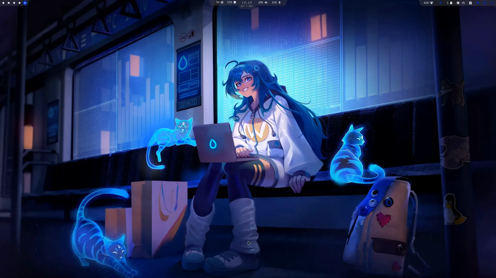
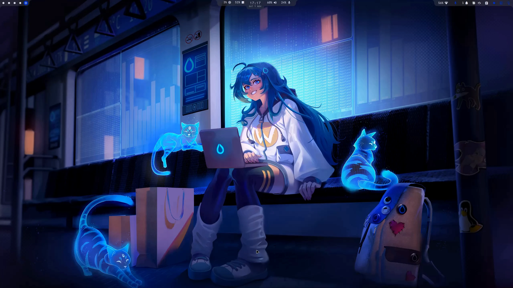
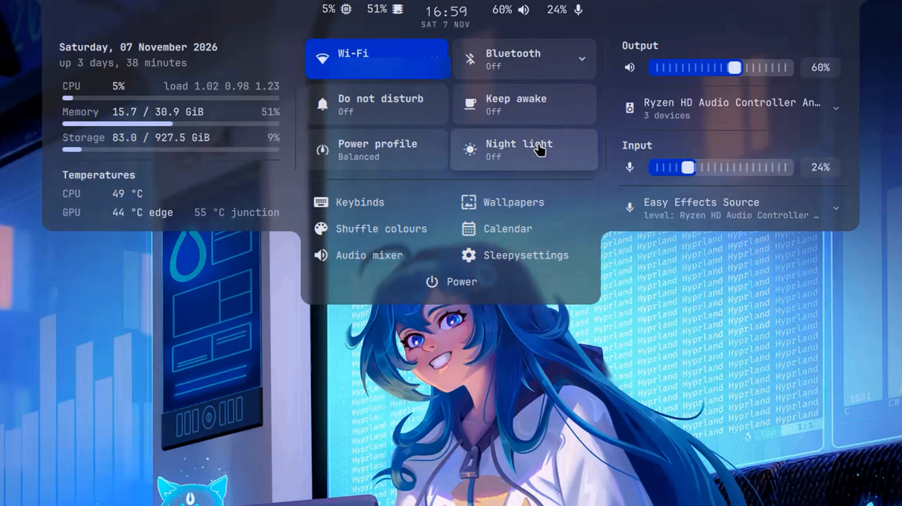
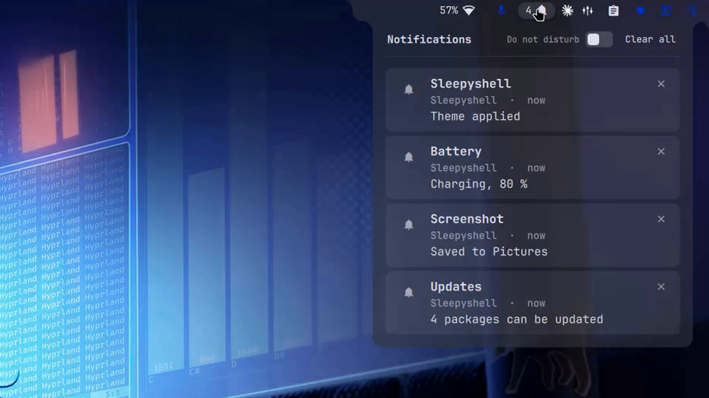
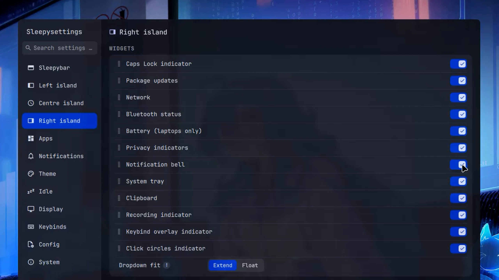
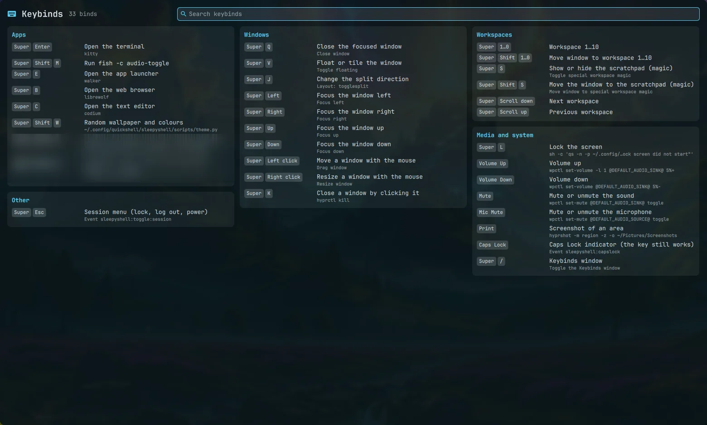
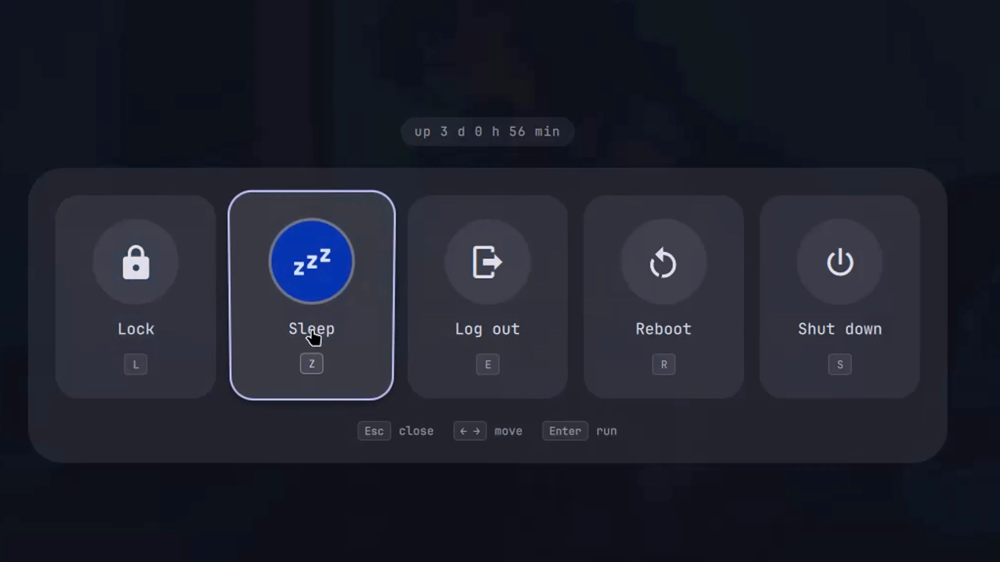
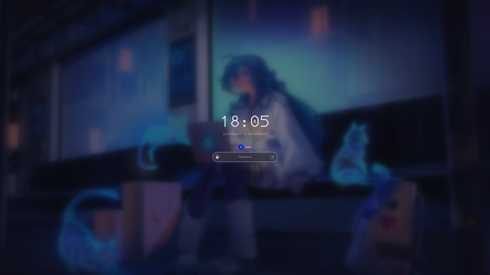

# Gallery

[Back to the README](../README.md)

What Sleepy Shell looks like: the slideshow from the top of the README, then each of its slides as a full-size
screenshot (2560x1440). Click an image to open it at full size.

## Contents

- [Slideshow](#slideshow)
- [Screenshots](#screenshots): [The desktop](#the-desktop) · [Control centre](#control-centre) · [Notifications](#notifications) · [Sleepysettings](#sleepysettings) · [Theming](#theming) · [Keybinds window](#keybinds-window) · [Session menu](#session-menu) · [Lock screen](#lock-screen)
- [Planned clips](#planned-clips)

## Slideshow

The top of the README: the eight screenshots below, each sliding in from the right like a workspace switch.

## Screenshots

### The desktop

The bar at rest: three islands on the top edge. Workspaces on the left; the clock with CPU, memory and audio in the centre; the widgets and indicators on the right.

### Control centre

The centre island grown into the control centre: the date, uptime and system panel, the quick-setting tiles, the tools, and the output and input audio panels.

### Notifications

The notification list under the bell, with Do not disturb and Clear all.

### Sleepysettings

The settings app on its Right island tab: every widget of the right island, dragged to reorder and switched to hide.

### Theming

A new wallpaper and its palette: the bar recolours itself from the wallpaper through matugen.

### Keybinds window

Every keybind of the Hyprland config, grouped and searchable, each with a plain description of what it does.

### Session menu

Lock, Sleep, Log out, Reboot and Shut down, with a letter key each; the last three must be held for a moment.

### Lock screen

Its own process: the wallpaper blurred, the clock and date, and the password field. The name above the field is a placeholder.

## Planned clips

Clips still to come, one feature per clip, each later with a page of its own.

Some clips come from an automated run: an empty workspace with Hyprland's own fallback wallpapers
(`/usr/share/hypr/wall*.png`) and the cursor driven through a virtual pointer. The settings clip is an
automated tour that drives the window through its IPC.

### The centre island

| File | What it shows |
|---|---|
| `control-centre.webp` | **Control centre.** The centre island grows into the control centre when the cursor reaches the clock and closes when it leaves. |
| `tile-tilt.webp` | **Lift and tilt.** The hover effect on the quick-setting tiles as the cursor crosses them. |
| `tile-do-not-disturb.webp` | **Do not disturb**, on and off. |
| `tile-keep-awake.webp` | **Keep awake**, an idle inhibitor, on and off. |
| `tile-night-light.webp` | **Night light**, on and off. |
| `tile-bluetooth.webp` | **Bluetooth**, the adapter on and off. |
| `tile-power-profile.webp` | **Power profile**, cycled through the profiles and back. |
| `audio.webp` | **Audio panels.** A click on the pill opens the output and input panels; the slider moves the volume. |
| `pill-scroll.webp` | **Scroll on the pill** changes the volume. |
| `pill-mute.webp` | **Right click on the pill** mutes and unmutes. |
| `calendar.webp` | **Calendar** from the tools: a day, the next month, Today. |
| `session.webp` | **Session menu** from the Power button: Lock, Sleep, Log out, Reboot, Shut down; the last three must be held. |
| `wallpaper.webp` | **Wallpapers** from the tools: the thumbnails, a click sets the wallpaper and its palette. |
| `shuffle-wallpaper.webp` | **Shuffle wallpaper:** another wallpaper, every colour of the shell follows through matugen. |
| `shuffle-colours.webp` | **Shuffle colours:** a new palette for the same wallpaper. |

### The side islands

| File | What it shows |
|---|---|
| `island-extend.webp` | **Extend.** A side island widens so its dropdown hangs flush under it, as one shape. |
| `island-float.webp` | **Float.** The same dropdown as a floating card under the island. |
| `workspaces.webp` | **Workspaces.** Clicks on the dots; the accent disc slides, a filled dot has windows, a ring is empty. |
| `updates.webp` | **Updates.** The count on the bar and the dropdown with the packages. |
| `notifications.webp` | **Notifications.** Ten toasts arrive, the queue folds into a pill, one toast is held under the cursor. |
| `notification-list.webp` | **The list.** The bell opens it, it scrolls. |
| `card-tilt.webp` | **Lift and tilt** on the notification cards. |
| `clear-all.webp` | **Clear all** sweeps the cards out one by one. |

### Sleepysettings

| File | What it shows |
|---|---|
| `settings.webp` | **Sleepysettings.** Opened from the tools, then an automated tour through the window's IPC: corners, opacity, bar height, motion, dot shapes, the clock, the readouts, a hidden widget, test notifications, a palette shuffle, a look at every tab. Every change shows on the bar at once and is put back; nothing is written. |
| `wallpaper-settings.webp` | **Choose wallpaper.** The picker opened from the Theme tab. |

Not recorded yet: drag and drop in the settings editors, the lock screen (a still is above), a community
theme preset, the Caps Lock peek, the polkit prompt, the Bluetooth list.

[Back to the README](../README.md)
